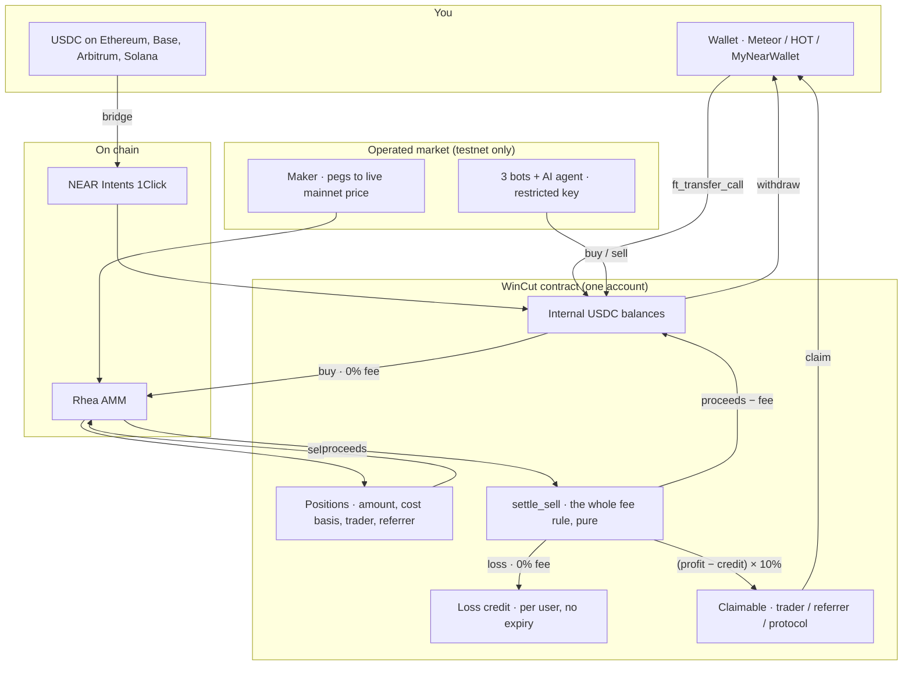

# WinCut

**Every trading app gets paid when you lose. WinCut doesn't.**

Live: **https://wincut.vercel.app** (NEAR testnet) · Demo video: _`<2-min walkthrough — link pending>`_

Binance and Bybit already pay lead traders only on profit. But the exchange still charges you on
every trade, win or lose. WinCut takes the rule all the way down the stack: the platform, the
copied trader and the referrer all earn only when **you** profit. Buying is free. Selling at a
loss is free, and the loss is banked as a credit that shelters your next win.

---

## The fee, in two trades

| | $100 → $120 | $100 → $80 |
|---|---|---|
| Conventional app (1% in + 1% out) | $2.20 | $1.80 |
| **WinCut** | **$2.00** (10% of the $20 profit) | **$0.00** — and **$20 credit** banked |

The $20 of credit shelters the next $20 of profit, so the loss has to be earned back before the
platform earns anything. Any fee splits **50% copied trader / 20% referrer / 30% protocol**. An
absent trader or referrer hands their share to the protocol; it is never charged to you twice.

Honest trade-off: a user who only ever wins pays more here than 1%-in-1%-out. The landing page
says so in those words.

---

## Screenshots

_Pending: `docs/img/trade.png`, `docs/img/dashboard.png`, `docs/img/agent.png`._

---

## Why it can't be gamed

- **The contract holds the position, not the user.** Tokens land in the contract's own account
  under a position record (amount, cost basis, copied trader, referrer). No method moves a
  token out. **Only USDC withdraws** — `withdraw` and `claim` touch the USDC ledger only — so a
  position cannot be smuggled out to dodge settlement.
- **One pure function decides the fee.** [`math::settle_sell`](near-contract/src/math.rs) is the
  whole rule, and `quote_sell_fee` is a view running that same function: the fee shown before
  you sign is the fee charged.
- **The AI agent cannot touch funds.** Its key is read live from chain:

```bash
near account list-keys agent.wincut-mansi.testnet network-config testnet now
```

| public key | permission | receiver | methods | allowance |
|---|---|---|---|---|
| `ed25519:CXC42ZPC…` | FunctionCall | `wincut-mansi.testnet` | `buy`, `sell` | 1.94 / 2 NEAR |
| `ed25519:DzCtqezk…` | FullAccess | — | — | — |

The agent process holds **only** the first key — its public key derives from `agent/.env` and
matches `CXC42ZPC…`. The second is the operator's, kept offline in `~/.near-credentials`,
because a NEAR account cannot be created without one. So: no `withdraw`, no `claim`, no
`ft_transfer`, and no attached deposit — a function-call key cannot attach NEAR at all.

---

## The AI agent

A separate Node process ([`agent/`](agent/)) that reads the chain, decides, and signs with that
restricted key.

- **Brain:** NEAR AI Cloud (`anthropic/claude-haiku-5-5` via `https://cloud-api.near.ai/v1`).
  It is given each market's price, candle-by-candle **% moves** (so a 5.6e-9 memecoin reads the
  same as a $3 token), depth, its own balance and open positions.
- **Hard limits in code, not in the prompt** ([`agent/src/risk.ts`](agent/src/risk.ts)): 20% of
  balance per trade, **1.5% of pool depth** per trade, 3 open positions, −8% stop loss, +12%
  take profit, 12 trades per rolling day. The risk layer **trims** an oversized buy to the
  binding cap rather than refusing it, and names which cap bound it.
- **Deterministic fallback:** with no API key, or when the model errors, a momentum rule decides
  instead. The log says which one acted on every pass, every time.
- The stop loss is not decoration: the agent is currently **−38.09 tUSDC** across 23 trades and
  13 losses. Those numbers are below, unedited.

---

## Why NEAR, and why this is a business

**Why NEAR:** function-call access keys are what make this design auditable — "the agent may
call exactly `buy` and `sell` on exactly this contract, with at most 2 NEAR of gas" is one
on-chain object a judge can read, not a promise in a README. Plus sub-second finality, gas in
tenths of a cent, one deep AMM to route through, and NEAR Intents for USDC bridged from
Ethereum, Base, Arbitrum or Solana.

**Why it is a business:** 10% of realised profit is a *higher* take-rate on winning volume than
1%-in-1%-out, so this is a bet that fee-free losses buy more winning volume than they cost. A
banked credit is a reason to come back, because leaving abandons it. The trader's 50% is an
acquisition budget paid only on results. And credits, cost bases and copy relationships are
contract state, so a fork starts at zero.

---

## The testnet market is operated, and says so

Every number on the site is real on-chain data from NEAR **testnet**. Testnet has no liquid
market, so WinCut runs one, and the UI discloses it on every affected panel.

| market | pool | mirrors (mainnet) | peg source | depth |
|---|---|---|---|---|
| MNEAR | #2961 | NEAR | `wrap.near` via #4512 | ~993 tUSDC |
| MDRAGON | #2963 | BLACKDRAGON `blackdragon.tkn.near` | #4512 → #4276 | ~402 tUSDC |
| MSHITZU | #2964 | SHITZU `token.0xshitzu.near` | #4512 → #4369 | ~402 tUSDC |
| MLONK | #2965 | LONK `token.lonkingnearbackto2024.near` | #4512 → #4314 | ~421 tUSDC |

A market maker reads the **live mainnet price** of each real token every 60s and swaps against
the testnet pool to hold it within ±0.6%. Three strategy bots (momentum, mean-reversion, grid)
and the AI agent trade into those pools. Every trade is a real signed transaction through a real
AMM, and every chart point came from a pool read this system performed. Mirror prices track
mainnet; **mirror liquidity does not**.

Mainnet ids, pools and decimals are each verified by RPC view call in
[`addresses.near.json`](near-contract/addresses.near.json) (block 224,250,070;
`node scripts/verify-mainnet.mjs` re-checks and exits non-zero on drift). Switching over is one
env var: `NEXT_PUBLIC_NETWORK=mainnet`.

---

## Live audit numbers

Read from chain while writing this, on 2026-11-14. Reproduce any row with the view call named.

| | value | how |
|---|---|---|
| Settled trades | **223** (137 buys, 86 sells) | `get_config.total_trades` |
| Notional through the ring | **2,763.85 tUSDC** | `get_recent_trades` |
| Losing sells | **76** | `get_recent_trades` |
| **Losing sells charged a fee** | **0** | every one has `fee: "0"` |
| Profitable sells | **11** | `get_recent_trades` |
| Fees charged, all time | **0.00 tUSDC** | every profit so far was smaller than that account's banked credit |
| Loss credit banked | **87.13 tUSDC** | `get_loss_credit` |
| Contract holds | **1,106.27 tUSDC** | `thusdc.testnet.ft_balance_of(wincut-mansi.testnet)` |
| Contract owes | **1,106.27 tUSDC** | `get_usdc_accounted` |
| Surplus / shortfall | **0.00 / 0** | the two above, and `get_config.shortfall_usdc` |

Loss credit per account: `agent` 38.09, `revert` 21.16, `grid` 16.52, `momo` 11.36.

The zero-fee row is the thesis running live: 76 losses cost nothing and banked 87 tUSDC of
credit, and all 11 wins since were smaller than that credit, so the platform has earned
**nothing** here — exactly what the rule says should happen to a market that is down. The
claimable ledger reads `"0"` for every account, the protocol included.

---

## How it works



A sell measures its own proceeds: Rhea's instant swap reports only how much *input* it used, so
the contract tracks what it ought to hold, takes a global lock, and reads the real balance two
blocks later — the payout receipt is queued on the token's shard strictly before that read. Every
failure path (refused swap, partial fill, bounce, unmeasurable proceeds, missing callback) ends
with the user whole and has a test; `release_stale_lock()` is public after five minutes.

---

## Proof on chain

| | link |
|---|---|
| Contract (223 trades, every receipt) | [`wincut-mansi.testnet`](https://testnet.nearblocks.io/address/wincut-mansi.testnet) |
| AI agent (restricted key, 23 trades) | [`agent.wincut-mansi.testnet`](https://testnet.nearblocks.io/address/agent.wincut-mansi.testnet) |
| Market maker (the peg swaps) | [`mm.wincut-mansi.testnet`](https://testnet.nearblocks.io/address/mm.wincut-mansi.testnet) |
| Bots | [`momo`](https://testnet.nearblocks.io/address/momo.wincut-mansi.testnet) · [`revert`](https://testnet.nearblocks.io/address/revert.wincut-mansi.testnet) · [`grid`](https://testnet.nearblocks.io/address/grid.wincut-mansi.testnet) |
| The AMM the swaps cross | [`ref-finance-101.testnet`](https://testnet.nearblocks.io/address/ref-finance-101.testnet) |

A losing sell to read for yourself: trade id 142, `agent` selling MSHITZU at **−16.64 tUSDC**,
`fee: "0"`, credit banked. `get_recent_trades` returns it.

---

## Tests and running it

Node 20+, and Rust with `wasm32-unknown-unknown` for the contract.

```bash
node scripts/verify-mainnet.mjs          # every mainnet id/pool still as claimed

cd near-contract && cargo test           # 60 tests (settle_sell, every failure path)
wsl -d Ubuntu -- bash near-contract/build.sh all   # Windows without MSVC

cd agent && npm test                     # 71 tests — risk 34, prompt 19, rpc 18
cd bots  && npm test                     # 18 tests — rpc failover and cache

cd web && cp .env.example .env.local && npm install && npm run dev   # :4000
cd bots  && npm run bots                 # maker + 3 bots, all 4 markets
cd agent && npm start                    # DRY_RUN=1 to decide without signing
```

`bots/README.md` and `agent/README.md` cover the keys, env and the one-step-at-a-time
`near-cli-rs` commands for creating a mirror market.

## Known limitations

- **One settlement at a time, protocol-wide.** The lock refuses a concurrent trade for ~5 blocks
  with a clear message. Rhea's non-instant `swap` returns the exact output and would remove the
  measuring entirely, at the cost of a round trip.
- **The maker drains on a trend.** It sells the base token when the pool is rich and buys when
  it is cheap, so a sustained mainnet rally empties its base inventory and the peg drifts up
  until it is topped up. Right now MLONK is **+10.1%** and MNEAR **+1.4%** off peg for exactly
  that reason — the maker holds 0 MLONK and 0 wNEAR. The log reports the drift every minute
  rather than hiding it, and the UI shows the pool price, not the peg.
- **Market orders only**, and **copying is attribution, not mirroring** — naming a trader pays
  them a share of your profit fee, it does not place their trades for you.
- **Last 500 trades on chain**, older ones in the NEP-297 event log, so state cannot grow
  unbounded. `get_leaderboard` sorts the whole trader map in a view — fine here, wrong at 10k.
- **Mainnet buys and sells have never been signed.** The contract is deployed and exercised on
  testnet only. Every mainnet id is verified; nothing mainnet has been traded.
- **Not audited.** Hackathon code, 60 contract tests plus 89 in the off-chain packages.

---

## Layout

```
near-contract/   Rust, near-sdk 5.30, 60 tests · src/math.rs is the fee rule
web/             Next.js 15 · /trade, /dashboard ("The Cut Field"), /agent
bots/            market maker + momentum/mean-reversion/grid bots, 4 markets
agent/           the AI trader: NEAR AI Cloud brain, risk layer, restricted key
scripts/         verify-mainnet.mjs, print-deploy-commands.mjs
legacy-arc/      the earlier Uniswap v4 hook build on Arc, kept for history
docs/DEMO.md     two-minute demo script
```

Originally prototyped as a Uniswap v4 hook on Arc, then rebuilt for NEAR — the fee rule needed
to live in an account that custodies positions and keeps per-user credit, which is a contract,
not a hook. The Arc work is in [`legacy-arc/`](legacy-arc/).

MIT.
