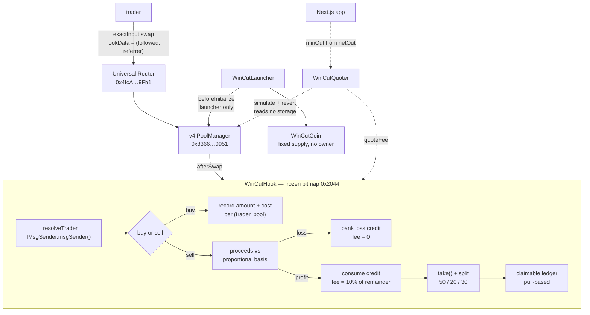

# WinCut

**A Uniswap v4 hook that charges a success fee only on realised profit.**

> Every trading app gets paid when you lose. We don't.

Built for ETHGlobal Mumbai 2026 · targeting **Uniswap Foundation**, **Arc (Circle)** and **World** partner prizes.

[Pitch and demo script](docs/PITCH.md) · [Demo checklist](docs/DEMO_CHECKLIST.md) · [Uniswap feedback](FEEDBACK.md)

---

## What it does

WinCut is a memecoin launchpad and social trading app on [Arc](https://docs.arc.io), Circle's L1 where USDC is the native gas token. The app, the trader you copied, and your referrer all earn **only when you make a profit**.

A profitable exit pays 10% of the gain, split **50% to the copied trader / 20% to the referrer / 30% to the protocol**. A losing exit pays **nothing** and banks a loss credit that offsets your next gain.

| | Sells for $150 | Sells for $60 |
|---|---|---|
| Result | $50 profit | $40 loss |
| WinCut's cut | **$5** | **$0** |
| Copied trader | $2.50 | $0 |
| Referrer | $1.00 | $0 |
| You keep | $145 | $60 |
| Plus | — | **$40 loss credit — your next $40 of profit is free** |

Pool fees and gas still apply on every trade: those go to Uniswap LPs and to the network, not to WinCut.

---

## Verified Arc mainnet addresses

Every address below was **bytecode-checked on chain** against `https://rpc.mainnet.arc.io`, not taken from a third party. Evidence and method in [`contracts/addresses.arc.json`](contracts/addresses.arc.json). Verified 2026-11-06 at block 29,830,463.

| Contract | Address | Verification |
|---|---|---|
| PoolManager | `0x8366a39CC670B4001A1121B8F6A443A643e40951` | 24,009 bytes; `owner()` responds |
| Universal Router | `0x4fcA4a51Ab4F23A7447b3284fBd7D73289A89Fb1` | 24,546 bytes; `execute()` + `msgSender()` (`0xd737d0c7`) present in bytecode, live call returns without reverting |
| PositionManager | `0x6049c9a0e26405C0985f9E3685C87d0aE917f82B` | 23,877 bytes |
| Permit2 | `0x000000000022D473030F116dDEE9F6B43aC78BA3` | 9,152 bytes; canonical |

### The quote currency is NATIVE USDC

`QUOTE = address(0)`, 18 decimals. **Decided from evidence, not assumed:**

- 129 of the `Initialize` events sampled across blocks 29,790,463–29,830,463 have `currency0 == address(0)`, so real Arc v4 pools pair against native USDC.
- A sampled live pool: `currency0 = 0x0`, `fee = 2500`, `tickSpacing = 50`, no hook.
- PoolManager held `2695092197412180258688951` native (18dp = $2,695,092) versus `2695297895145` via the ERC-20 `balanceOf` (6dp = $2,695,297) — a ratio of **1e12**.

USDC on Arc exists as the native asset at 18 decimals **and** as an ERC-20 interface at `0x3600…0000` at 6 decimals. Same money, 1e12 apart. Mixing them silently corrupts every cost basis, so the hook pins exactly one in an immutable and rejects pools built on the other. Native is also strictly safer: the check becomes `isAddressZero()`, which cannot be spoofed.

---

## Architecture



<details>
<summary>ASCII version</summary>

```
                    ┌──────────────────────┐
   trader ─────────▶│  Universal Router    │  exactInput swap + hookData
                    └──────────┬───────────┘    (followedTrader, referrer)
                               │
                               ▼
                    ┌──────────────────────┐
                    │   v4 PoolManager     │
                    └──────────┬───────────┘
                               │ afterSwap
                               ▼
         ┌─────────────────────────────────────────────┐
         │              WinCutHook                     │
         │                                             │
         │  resolve trader  ─ IMsgSender.msgSender()   │
         │  buy   ─ record (amount, cost) per pool     │
         │  sell  ─ proceeds vs proportional basis     │
         │          loss   → bank credit, fee = 0      │
         │          profit → consume credit, fee = 10% │
         │  take() the fee, split it, pull-based claim │
         └─────────────────────────────────────────────┘
                               ▲
                               │ beforeInitialize (launcher only)
                    ┌──────────┴───────────┐
                    │   WinCutLauncher     │  deploys coin, opens pool,
                    └──────────────────────┘  locks seed liquidity forever
```
</details>

### Contracts

| Contract | Role |
|---|---|
| [`WinCutHook.sol`](contracts/src/WinCutHook.sol) | Cost-basis ledger, profit-only fee, loss credits, fee split, pull-based claims |
| [`WinCutLauncher.sol`](contracts/src/WinCutLauncher.sol) | One-tx coin launch: deploy ERC-20, open the v4 pool, seed **permanently locked** liquidity |
| [`WinCutCoin.sol`](contracts/src/WinCutCoin.sol) | Fixed supply, no mint, no owner, no transfer tax, nothing that can rug |
| [`WinCutQuoter.sol`](contracts/src/periphery/WinCutQuoter.sol) | Gross + fee + net in one `eth_call`, reading no PoolManager storage |
| [`UniversalRouterLib.sol`](contracts/src/periphery/UniversalRouterLib.sol) | Shared V4_SWAP encoder, mirrored by `web/src/lib/swap.ts` |

---

## The design decisions that matter

Each is a deliberate choice with a reason. Links go to the exact lines.

### 1. Unidentified routers pay **zero**, not 10% of everything

[`WinCutHook.sol:233` — `_resolveTrader`](contracts/src/WinCutHook.sol#L233)

The naive design taxes any sell it cannot attribute. That would deter arbitrage, let the pool price drift above other venues (so *our own users* buy high), and get every launched coin flagged as a sell-tax token by sniffers and aggregators.

So an unknown router is charged nothing and recorded nothing. **The fee is opt-in.** You can always sell elsewhere, free. You pay us only when you use the app, and only when you win. That is a feature, not a leak.

### 2. Untracked coins are fee-free

[`WinCutHook.sol:270` — `_handleSell`](contracts/src/WinCutHook.sol#L270)

The hook sees swaps, never ERC-20 transfers, and **never reads `balanceOf`**. Coins arriving by airdrop or transfer carry no recorded basis and are never charged.

Treating them as 100% profit would mean **anyone could inflate your fee by dusting you** — and memecoin wallets get dusted constantly. Test: `test_Airdrop_CannotInflateFeeOnRealPosition`.

### 3. Loss credits are global, with no expiry

[`WinCutHook.sol:323` — `_applyCredit`](contracts/src/WinCutHook.sol#L323)

Per-coin credits would still tax a DUKE win while a PEPE loss sat unused. Global credits make the headline claim true at the portfolio level.

Farming credits is strictly unprofitable: banking $X of credit requires genuinely losing $X, which saves only $0.1X in future fees.

### 4. `quoteFee()` is the single source of truth

[`WinCutHook.sol:372` — `quoteFee`](contracts/src/WinCutHook.sol#L372)

The hook takes its fee from the swap **output**, and Universal Router checks `amountOutMinimum` against the post-hook amount. A frontend deriving `minOut` from the gross quote makes **every profitable sell revert**.

Measured on Arc:

| | USDC |
|---|---|
| gross out | 38,485.13 |
| hook fee | 3,648.51 |
| minOut from `netOut` (correct) | 34,662.43 → **succeeds** |
| minOut from gross (naive) | 38,292.71 → **exceeds achievable net, reverts** |

So the formula lives in the contract and the frontend calls it. **Never reimplement it in TypeScript.**

### 5. Permissions are frozen at `0x2044`

`beforeInitialize | afterSwap | afterSwapReturnDelta`, asserted in `test_HookAddress_CarriesFrozenPermissionBits` and `require()`d at deploy.

`PoolKey` contains the hook address, so adding a flag later changes the address, which changes every PoolKey, which invalidates every pool ever created. `beforeSwap` is deliberately **not** used: `afterSwap` sees both directions, so buys are recorded there too.

### 6. Claims are pull-based

[`WinCutHook.sol:358` — `claim`](contracts/src/WinCutHook.sol#L358)

USDC can blocklist addresses. If fees were pushed on every sell, one blocklisted recipient would make **other people's** trades revert. Earnings accrue and are pulled, CEI-ordered.

### 7. Only the launcher may open pools

[`WinCutHook.sol:182` — `_beforeInitialize`](contracts/src/WinCutHook.sol#L182)

Nobody can point a fake-token pool at a hook that custodies funds, and one side must be the pinned QUOTE.

---

## Tests

```bash
cd contracts && forge test                                    # 19 local
ARC_RPC=https://rpc.mainnet.arc.io forge test                 # 31 incl. fork
```

**31 passing, including 512 fuzz runs**, against a real `PoolManager` with a mined hook address.

### Local suite (19)

```
WinCutMoneyRules
  ✓ Profit_ChargesTenPercent_AndSplits        10% of gain, split 50/20/30
  ✓ Loss_ChargesNothing_AndBanksCredit        fee 0, loss banked exactly
  ✓ LossCredit_OffsetsFutureGain              credit consumed before any fee
  ✓ MultipleBuys_WeightedAverageBasis         proportional basis on partial exits
  ✓ UnknownRouter_NoFeeNoRecord               untrusted router charged nothing
  ✓ AirdroppedCoins_AreFeeFree                untracked coins never taxed
  ✓ Airdrop_CannotInflateFeeOnRealPosition    dusting cannot raise a fee

WinCutMechanics (10)   attribution guards, referrer locking, creator fallback,
                       claim + double-claim, pause, trade cap, rogue pools,
                       frozen bitmap, locked seed liquidity

WinCutFuzz
  ✓ FeeNeverExceedsTenPercentOfGain  (256 runs)  principal never touched
  ✓ NeverChargesOnALoss              (256 runs)  sale ≤ basis is always free
```

### Fork suites against real Arc v4 (12)

```
WinCutForkTest
  ✓ RealRouter_ExposesMsgSender       the live router's msgSender() is callable
  ✓ PoolLivesOnRealPoolManager        our pool opens on the real PoolManager
  ✓ NativeQuote_TakeAndClaim          hook accepts native value
  ✓ RejectsRoguePools                 wrong caller AND wrong quote currency
  ✓ FrozenPermissionBits              0x2044 survives deployment
  ✓ UsdcDecimalTrap_IsReal            native/erc20 ratio measured at exactly 1e12

WinCutRouterForkTest — real V4_SWAP through Arc's deployed Universal Router
  ✓ RealRouter_AttributesTheTrader    position recorded for the TRADER, 0 for the router
  ✓ Profit_FeeAndSplit                gain 7765.678 → fee 776.567 (10.000%), 50/20/30
  ✓ Loss_NoFee_BanksCredit            fee 0, credit 2.408394559130491083 exactly
  ✓ QuoteFeeDerivedMinOut_DoesNotRevert  proves the slippage trap numerically
  ✓ Claim_PaysRealNativeUsdc          388.283918696510675795 real native USDC
```

The delta sign convention is verified against `v4-core`'s `Hooks.afterSwap`, which applies `swapDelta = swapDelta - hookDelta` — so a positive returned `int128` takes from the user's output, and `take()` inside `afterSwap` nets the hook's own delta to zero within the same unlock.

### Frontend path

```bash
cd web && npx tsx scripts/verify-flow.ts
```

Exercises the real UI encoder against the real router. All checks pass: buy attributed with basis exactly $2,000, sell gross $38,485.13 → fee $3,648.51 → net $34,836.6179, trader actually received $34,836.6177 (2 wei of rounding), split 50/20/30 confirmed.

---

## Running it

### Phase 0 — verify the environment before building anything

```bash
cd contracts
UNIVERSAL_ROUTER=0x4fcA4a51Ab4F23A7447b3284fBd7D73289A89Fb1 \
  forge script script/Phase0.s.sol --fork-url https://rpc.mainnet.arc.io -vv
```

Answers the two questions the architecture rests on: does the live router expose `msgSender()`, and is USDC native or ERC-20. Expect `>>> OK` on both.

### One command for everything else

```bash
KEEP_ALIVE=1 ./scripts/dev.sh
```

Forks Arc mainnet, deploys at a mined address, funds clean undelegated wallets, seeds real trades through the real Universal Router, and writes `web/src/config/deployed.json`.

```bash
cd web && npm run dev
```

> **Why fork mainnet instead of using Arc testnet?** The testnet RPC is live (chain 5042002) but has **no confirmed v4 deployment**. A mainnet fork is the only way to work against the real PoolManager and the real Universal Router.

> **EIP-7702 warning.** Every well-known test address carries a delegation on Arc mainnet (`0xef0100…` → a sweeper that forwards any native USDC it receives). A fork inherits it, so anvil's default accounts must never hold demo funds. `dev.sh` derives project-specific undelegated wallets and asserts `code.length == 0` before funding them. **Never fund an anvil default address on Arc mainnet — it will be swept instantly.**

---

## Known limitations

Stated plainly, because they are real.

- **The fee is avoidable.** Anyone can create a hookless pool for the same coin, or route around the trusted router, and pay nothing. This is by design (decision 1), but it means revenue depends on people choosing to stay in the app. What WinCut sells is the signal and the honest leaderboard, not a tax.
- **Win-then-lose is asymmetric.** Loss credits fix `−$1000 then +$1000` (fee $0) but not `+$1000 then −$1000` (fee $100 on net-zero PnL). A high-water mark is mathematically identical and does not help. The real fix is escrowing fees for N days so a later loss refunds from pending — see roadmap.
- **Adverse selection.** A 10% profit fee is free for losing traders and expensive for winning ones, so the model systematically sheds the cohort that generates its revenue.
- **No indexer yet.** The leaderboard is built from hook events via `viem` `getLogs` over a bounded block window. Fine for a demo, not for scale.
- **World ID is not integrated.** The leaderboard shows all traders. Money is unaffected: attribution gaming is self-defeating, since a sock puppet crediting its owner returns 25% of a fee the puppet itself had to pay.
- **Economics unproven.** The replay against real Arc swap history, which is the experiment that decides whether 10%-of-profit out-earns 0.5%-of-volume, has not been run.

## Roadmap

1. **Escrow window** — fees pending for N days, refunded from pending on a later loss, closing the win-then-lose gap. Constructor parameter, short for a demo and 7 days in production.
2. **Wrapper contract** — apply the same rule to existing Arc pools, inside the app only, bypassable by design.
3. **Charge for the signal, not the swap** — restrict the success fee to copy-trades, where it is payment for a service rather than a toll. Winners then cannot route around it without giving up what they are paying for.
4. Real indexer (Envio), World ID gating, launch screen and social feed.

---

## Status

| Component | State |
|---|---|
| `WinCutHook` | ✅ complete, frozen bitmap `0x2044` |
| `WinCutLauncher` + `WinCutCoin` | ✅ complete, seed liquidity locked |
| `WinCutQuoter` + `UniversalRouterLib` | ✅ complete, storage-free quoting |
| Tests | ✅ 31 passing, 12 against real Arc v4 |
| Phase 0 / Deploy / Seed / `dev.sh` | ✅ complete, one command |
| Frontend — Trade, Result, Board, Me | ✅ builds clean, flow verified end to end |
| Browser visual pass | ⚠️ renders (HTTP 200, no runtime errors) but not visually confirmed in this environment |
| Indexer (Envio) | ⬜ not started |
| World ID | ⬜ not started |

Licence: MIT.
