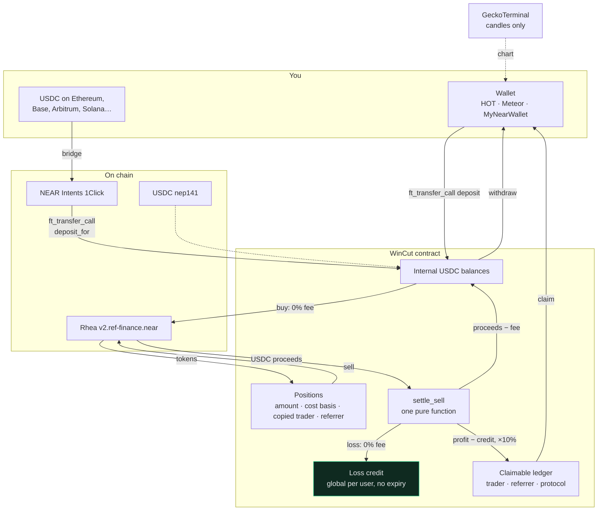

# WinCut

**Copy trading on NEAR where the fee only ever comes out of profit.**

Buying is free. Selling at a loss is free, and the loss is banked as a credit that shelters your
next win. Only a realised profit is charged — 10% of it — split with the trader you copied and
whoever referred you. Built for the NEAR Hackathon, Unstoppable DeFi track.

---

## The fee, in one table

A conventional copy-trading app takes roughly 1% going in and 1% going out, win or lose. Here is
a run of five $1,000 trades of the kind people actually have — three losers at −20%, one flat,
one winner at +50%:

| | 1% in + 1% out | WinCut |
|---|---|---|
| Three −20% trades | $54.00 | **$0.00** — and $600 of credit banked |
| One flat trade | $20.00 | **$0.00** |
| One +50% trade | $25.00 | **$0.00** — the $500 profit is under the $600 of credit |
| **Total on a run that ended $100 down** | **$99.00** | **$0.00** |

Run the same five trades with no losers first and WinCut costs **more**: 10% of a $500 profit is
$50 against $25 for the 1% model. That is the deal, and the landing page says so in those words.
You pay nothing on the trades that fail and more on the ones that work.

The split of any fee is 50% to the copied trader, 20% to the referrer, 30% to the protocol. An
absent trader or referrer hands their share to the protocol — it is never charged to you twice.

---

## Verified mainnet contracts

Every id below was read from NEAR mainnet by RPC view call at block 224,250,070, not from
memory. `node scripts/verify-mainnet.mjs` re-checks all of them and exits non-zero on any drift.

| | account | notes |
|---|---|---|
| **Rhea Finance** (swaps) | `v2.ref-finance.near` | classic AMM, v1.9.21 |
| **USDC** | `17208628f84f5d6ad33f0da3bbbeb27ffcb398eac501a31bd6ad2011e36133a1` | native Circle USDC, 6 decimals |
| **wNEAR** | `wrap.near` | 24 decimals |
| **WinCut** | *not deployed yet* | see [Deploying](#deploying) |

### Markets

USDC has exactly one deep Rhea pool on mainnet — USDC/wNEAR, #4512. Everything else is quoted
against wNEAR, so trades route **USDC → wNEAR → token** as one two-hop Rhea swap.

| token | account | dec | route | usable liquidity |
|---|---|---|---|---|
| wNEAR | `wrap.near` | 24 | #4512 | ~$1.88M |
| RHEA | `token.rhealab.near` | 18 | #4512 → #6458 | ~$778K |
| SHITZU | `token.0xshitzu.near` | 18 | #4512 → #4369 | ~$47K |
| BLACKDRAGON | `blackdragon.tkn.near` | 24 | #4512 → #4276 | ~$37K |
| LONK | `token.lonkingnearbackto2024.near` | 8 | #4512 → #4314 | ~$20K |
| BRRR | `token.burrow.near` | 18 | #4512 → #3474 | **~$4.5K** |

"Usable liquidity" is the *thinnest* pool on the route, not the first. Every route starts at the
deep USDC/wNEAR pool, so reporting the first hop would claim $1.88M for all six. BRRR and LONK
carry a thin-pool badge in the UI for this reason.

Two things differ from what you might expect: there is no RHEA token at a `ref-finance` id — the
live one is `token.rhealab.near`, while `token.v2.ref-finance.near` is still the old REF token.
And no listed token except wNEAR has a direct USDC pool.

---

## How it works



### The rules the contract enforces

All of it lives in one pure function, [`math::settle_sell`](near-contract/src/math.rs):

```
basis_part = cost_basis × sell_amount / position_amount
pnl        = proceeds − basis_part

pnl < 0  →  fee = 0, and loss_credit += −pnl
pnl ≥ 0  →  used = min(loss_credit, pnl)
            loss_credit −= used
            fee = (pnl − used) × 10%
            fee splits 50 trader / 20 referrer / 30 protocol
```

`quote_sell_fee` is a view that runs that same function, so the fee the order panel shows before
you sign is the fee that gets charged — the only difference being slippage between the quote and
the fill.

Every intermediate widens to 256 bits. `cost_basis × sell_amount` for a 24-decimal token is
around 1e43, and u128 stops at 3.4e38.

### How a swap's output is attributed

Rhea's instant swap does not report how much came out — `ft_transfer_call` only returns how much
of the *input* was used. So the output is measured rather than reported:

1. the contract tracks exactly how much of each token it ought to hold
2. a global lock keeps one settlement in flight at a time
3. the callback asks the token for the real balance, and the difference is the output

The measuring read is deliberately a **second** round trip. Rhea's payout receipt is created
while its `ft_on_transfer` runs, so it is queued on the token's shard strictly before the
`ft_balance_of` this contract sends two blocks later, and shards drain their queues in order.
By the time the balance is read, the payout has always landed.

That same lock also covers `withdraw` and `claim`: a payout in flight would move the very USDC
balance a sell settlement is about to measure.

### Failure paths

Every one ends with the user whole, and each has a test:

| what went wrong | what happens |
|---|---|
| Rhea refuses the swap | full USDC refund to the internal balance, lock released |
| Rhea fills only part of it | the remainder is refunded, the basis is what was actually spent |
| a sell's swap bounces | the position is untouched and nothing is charged |
| proceeds cannot be measured | the sale is abandoned, no fee, position intact |
| filled but the output never arrives | the user is refunded from protocol funds, the gap is recorded for `sweep_rhea` |
| a callback never runs | `release_stale_lock()` is callable by anyone after five minutes |

---

## Running it

You need Node 20+ and Rust with the `wasm32-unknown-unknown` target.

```bash
git clone https://github.com/Mansi2007275/WinCut && cd WinCut

# 1. check every mainnet id and pool is still what the repo claims
node scripts/verify-mainnet.mjs

# 2. the contract
cd near-contract
cargo test                       # 60 tests
cargo build --release --target wasm32-unknown-unknown
cd ..

# 3. the app
cd web
cp .env.example .env.local       # fill in NEXT_PUBLIC_CONTRACT_ID once deployed
npm install
npm run dev                      # http://localhost:4000
```

Without a contract id the app still shows live prices, pool depth and charts for all six
markets — those come from Rhea and GeckoTerminal and need no WinCut. Balances, positions, fees
and trading say plainly that they need a deployment.

On Windows without the MSVC build tools there is no host linker, so `cargo` cannot build.
`near-contract/build.sh` runs the whole toolchain inside WSL instead:

```bash
wsl -d Ubuntu -- bash near-contract/build.sh all     # test + wasm
```

---

## Deploying

WinCut never asks for your key. This prints every command for you to run yourself:

```bash
node scripts/print-deploy-commands.mjs wincut.youraccount.near youraccount.near
```

It generates the `cargo-near` and `near-cli-rs` sequence from the verified addresses file, so
the pool ids baked into each `list_token` call are the ones that were checked on chain. The
steps are: create the sub-account, build reproducibly, deploy with `new`, register the contract
on USDC, `list_token` each of the six markets, then `register_token` each one — which pays the
NEP-145 storage on both the token and Rhea and is what makes it tradable.

Budget about 6 NEAR for the sub-account and 0.05 NEAR per token registration.

---

## Where every number comes from

Three sources, and nothing else. There is no mock data anywhere in the UI, and no fallback that
invents a number when a source is unavailable — screens say what is missing instead.

| shown | source |
|---|---|
| price, pool depth, price impact, "you receive" | Rhea pool reserves, read live |
| the quote confirmed before signing | Rhea `get_return` |
| candles, 24h change, 24h volume, swap pressure | GeckoTerminal (`refv1-<pool id>`) |
| balance, position, cost basis, loss credit, earnings | WinCut contract |
| the exact fee a sell will charge | WinCut `quote_sell_fee` |
| block height, gas price | NEAR RPC |

The trade screen cross-checks the two independent prices it has — the live pool mid against
GeckoTerminal's indexed one — and tells you when they disagree by more than a quarter rather
than quietly picking one. GeckoTerminal is proxied through a cached route handler; its ~30
requests a minute would not survive one browser polling candles, let alone several viewers.

---

## Known limitations

Worth reading before the demo, because they are all deliberate.

- **One settlement at a time, protocol-wide.** The balance-delta attribution needs a global
  lock, so while somebody's trade is settling (about five blocks) another is refused with a
  clear message. The fix is Rhea's non-instant `swap`, which returns the exact output amount and
  would remove the need to measure at all; it costs an extra round trip and was not worth it
  before the deadline.
- **Market orders only.** A limit order needs a keeper watching the pool between blocks.
- **Copying is attribution, not mirroring.** Naming a trader credits them with a share of your
  profit fee. It does not place their trades for you — that would need standing permission over
  your balance.
- **The last 500 trades are on chain.** Older ones are in the NEP-297 event log, readable by any
  indexer, but the contract stops storing them so its state cannot grow without bound.
- **`get_leaderboard` reads the whole trader map** and sorts in the view. Fine at this size,
  wrong at ten thousand traders.
- **BRRR is a ~$4.5K pool.** It is listed because the brief asked for it. The depth ladder shows
  exactly what each size would fill at, so a bad price is visible before signing.
- **Bridged deposits land in your NEAR wallet by default.** Delivering straight into the WinCut
  balance uses 1Click's `customRecipientMsg`, which its own documentation calls highly
  experimental, so it is opt-in.
- **Not audited.** It is hackathon code with 60 tests and real money on mainnet. Trade small.

## What has and has not been exercised on mainnet

Honest status, because "it works end to end" should mean something:

- **Verified against mainnet:** every contract id, pool id and decimal; live prices for all six
  markets cross-checked against GeckoTerminal; the depth ladder; candles across all six
  timeframes; the 1Click quote endpoint ($25 on Base → 24.995 USDC on NEAR, ~35s).
- **Verified in tests only:** the full buy and sell settlement, the fee split, loss-credit
  banking and consumption, and every failure path — 60 unit tests against a simulated VM.
- **Not yet run on mainnet:** signing an actual buy or sell, because that needs the contract
  deployed from your account and real USDC. The deploy commands above are the remaining step.

---

## Layout

```
near-contract/      Rust contract (near-sdk 5.30), 60 tests
  src/math.rs         settle_sell — the whole fee rule, pure and tested
  src/trading.rs      buy, sell, and the settlement callbacks
  src/ft.rs           deposits, withdrawals, claims
  addresses.near.json every verified mainnet id, with the block it was read at
web/                Next.js 15, Tailwind 4, lightweight-charts
  src/lib/rhea.ts     pool maths: quotes, depth, mid price
  src/lib/contract.ts every contract view the UI reads
  src/lib/intents.ts  1Click cross-chain deposits
scripts/            verify-mainnet.mjs, print-deploy-commands.mjs
legacy-arc/         the previous Uniswap v4 build on Arc, kept for history
docs/DEMO.md        a two-minute demo script
```

MIT.
